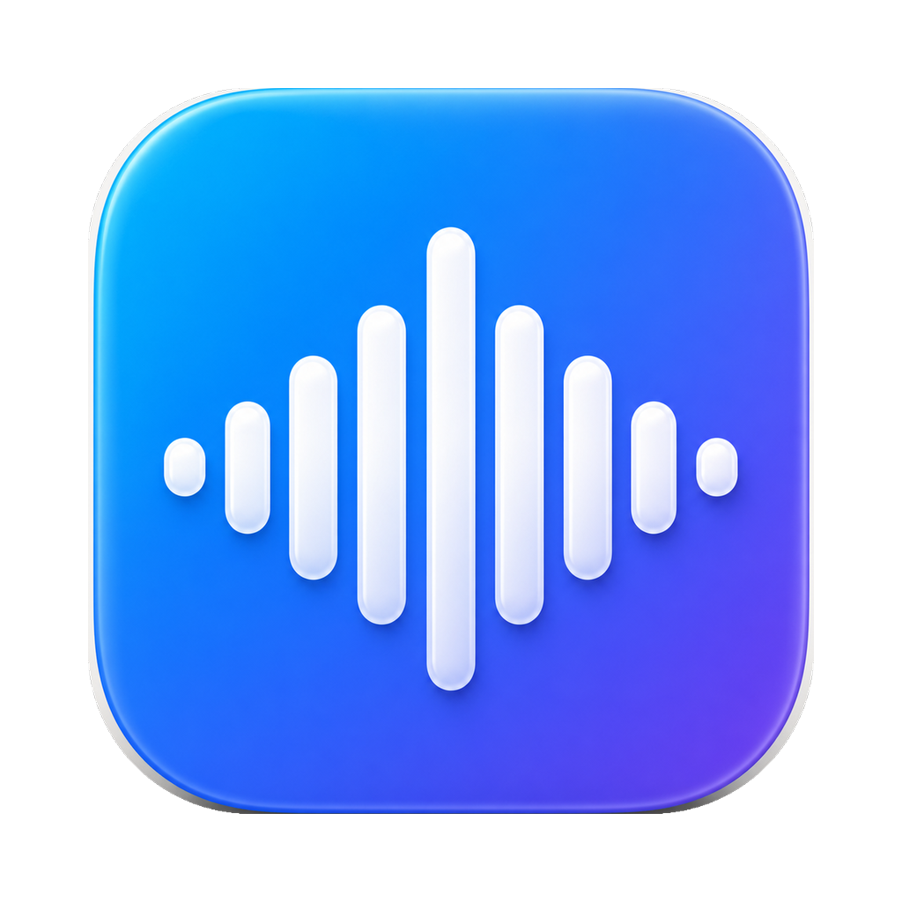
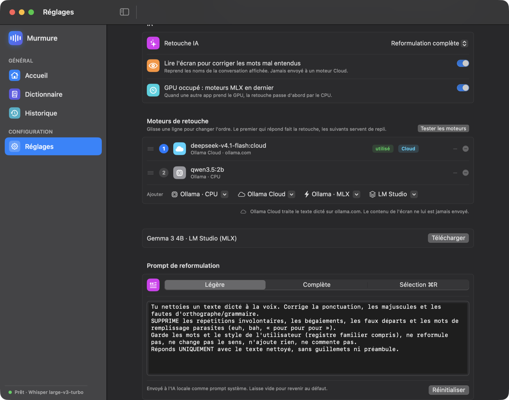

<div align="center">



# Murmure

**Local voice dictation for macOS.**
Press a key, speak, and get clean text right where your cursor is — 100% on your Mac.

[](https://www.apple.com/macos/)
[](LICENSE)
[](#privacy)

### [▶ Try the live demo](https://hugo291.github.io/Murmure/)

</div>

---

Murmure is a tiny menu-bar app. You hold a key, talk, and it transcribes your speech **locally** (no cloud, no account), runs it through a **local AI** to clean up filler words and punctuation, and pastes the result at your cursor — in any app, including the browser.

It's the privacy-respecting, free, open-source take on tools like Wispr Flow or Typeless.

## Why Murmure

- **Truly private** — speech recognition ([whisper.cpp](https://github.com/ggerganov/whisper.cpp) or [Parakeet](https://github.com/FluidInference/FluidAudio)) and AI cleanup ([LM Studio](https://lmstudio.ai) / [Ollama](https://ollama.com)) run entirely on your Mac. Cloud models are strictly opt-in.
- **Fast transcription** — Whisper `large-v3-turbo` by default, or **Parakeet v3** (NVIDIA, on the Neural Engine) — about 10× faster, slightly less accurate.
- **Clean text, not a transcript** — an LLM removes "um", "uh", stutters and repetitions, fixes punctuation and casing, while keeping *your* words and style. French numbers are written as digits ("vingt-trois" → 23).
- **Your engines, your order** — list the AI models you want (Ollama on CPU, MLX on GPU, LM Studio, or **Ollama Cloud**) and drag them into priority order: the first one that answers does the cleanup, the others are fallbacks. When another app keeps the GPU busy, MLX models can step aside automatically.
- **Reads the conversation you're answering** — optionally, Murmure reads the text shown in the window (e.g. a Claude chat) so the cleanup restores mis-heard names, files and terms, and stays on topic. That screen text never goes to a cloud model (cloud engines get the prompt without it).
- **Pastes anywhere** — native fields, Electron apps, and web inputs (Chrome included).
- **Live feedback** — a compact card shows a real-time audio spectrum while you speak, then the phase (transcription, touch-up) with a timer and, optionally, the model at work. Need the text now? A lone tap on **Shift** skips the AI touch-up and pastes the raw transcript.
- **Live preview** — your words appear in real time above the overlay as you talk (Apple's on-device speech), then vanish; the final pasted text still comes from the transcription model.
- **Learns your vocabulary** — correct a transcript and Murmure remembers the term, then reuses it to transcribe better next time.
- **History** — dictations grouped by the field they went into, with "Copy all"; for dictations into Claude, the app icon and a clean digest of the conversation on screen.
- **Editable shortcuts** — rebind every command from the menu, with conflict warnings.
- **Parallel dictations** — fire several at once; they're delivered in the order you started them, so your text never gets scrambled. The overlay follows the screen of the field you're typing in.
- **Optional audio replay** — enable “Keep audio for 20 minutes” in Settings to replay or re-transcribe recent dictations from History. Local WAV copies expire automatically (cleanup resumes on launch if the app was closed), with a 50 MB cap that removes the oldest first. Disabled by default; disabling or clearing history deletes saved audio. Reanalysis uses the current transcription model and updates the text directly in History without a popup.
- **Mutes system audio** while recording (like Typeless), and restores it after — and, if you enable them, your **Google Cast TVs and speakers** too (via [`catt`](https://github.com/skorokithakis/catt)).
- **English & French** interface, switchable from the menu.

## Install

### Option A — one command (recommended)

Installs the dependencies, downloads the speech model, builds and signs the app, and launches it. Everything works out of the box:

```bash
/bin/bash -c "$(curl -fsSL https://raw.githubusercontent.com/Hugo291/Murmure/main/install.sh)"
```

The installer pulls in Homebrew, `whisper-cpp`, LM Studio and `ollama` if you don't already have them.

### Option B — download the app

Grab the latest **[Murmure.dmg](https://github.com/Hugo291/Murmure/releases/latest)**, open it, and drag **Murmure** into **Applications**.

Murmure is free and self-signed (not notarized by Apple), so the **first launch** needs one extra step:

1. Double-click Murmure → macOS says it can't verify the developer. Click **Done**.
2. Open **System Settings › Privacy & Security**, scroll down, and click **Open Anyway** next to the Murmure message — then confirm.
   *(Equivalent in Terminal: `xattr -dr com.apple.quarantine /Applications/Murmure.app`.)*

The DMG ships the **app only** — the speech and AI engines aren't bundled. Install them once with Homebrew:

```bash
brew install whisper-cpp ollama          # speech-to-text + local AI cleanup
```

Then, from Murmure's menu, download a **transcription model** and an **AI model** in one click each.

Requirements: **macOS 14 (Sonoma) or later**.

### First launch

Murmure lives in the menu bar (the 🎙 mic, top-right). On first run, grant three permissions in **System Settings › Privacy & Security**:

| Permission | Why |
|---|---|
| **Microphone** | to hear you |
| **Input Monitoring** | to detect the Fn key globally |
| **Speech Recognition** | optional — for the real-time live preview (on-device) |
| **Accessibility** | to paste text at the cursor |

> **Tip:** in System Settings › Keyboard, set *"Press 🌐/Fn key to"* → *"Do Nothing"* so Fn is free for dictation.

## Usage

| Shortcut | Action |
|---|---|
| **Fn** | Start / stop dictation (tap to start, tap again to transcribe & paste) |
| **Esc** | Cancel the current recording or processing |
| **⇧ Shift** (tap alone) | Skip the AI touch-up and paste the raw transcript |
| **⌘L** | Paste the last dictation again |
| **⌘R** | Rewrite the selected text (strip filler & repetition, keep the meaning) |

All shortcuts are editable: **menu › Settings › Commands › Edit shortcuts…**

Press **Fn**, talk, press **Fn** again. The text lands at your cursor. That's it.

## How it works

```
  Fn ─► record (AVAudioEngine) ─► whisper.cpp / Parakeet ─► AI engines, in your order ─► paste at cursor
        live spectrum overlay       on-device transcription   filler/punctuation cleanup
```

The speech models live in `~/Library/Application Support/Murmure/`. AI cleanup walks your
**engine list** top to bottom and uses the first engine that answers, so cleanup keeps
working when a server is off.



Tune all of this from **Settings**:
- **AI touch-up** — raw text, light cleanup (default), or full rewrite.
- **Touch-up engines** — add models by family: *Ollama · CPU*, *Ollama Cloud*, *Ollama · MLX* and *LM Studio* (every downloaded language model, loaded or not). Drag rows to reorder, right-click to move or remove; each row shows whether its server is off or the model is missing. *Test engines* times each one. No model yet? *Download* fetches Gemma in one click, for Ollama or LM Studio.
- **Read the screen** — use the visible conversation to fix mis-heard words (local engines only).
- **GPU busy: MLX engines last** — when another app holds the GPU, CPU engines go first.
- **Transcription model** — Parakeet v3 or any whisper size (tiny → large-v3), downloaded from Hugging Face in one click with a live progress bar.
- **Show the model under the spectrum** — transcription model while recording/transcribing, cleanup engine during touch-up.
- **Dictation language** — French, English, or auto.
- **Language** — interface language (English by default, French available).

### Ollama Cloud (opt-in)

Models such as `kimi-k3:cloud`, `glm-5.3:cloud` or `gpt-oss:120b-cloud` run on ollama.com through
your local Ollama server (sign in with `ollama signin`). Add one from *Ollama Cloud* in the engine
list only if you accept that **the dictated text** is sent to ollama.com. The screen text is never
sent: a cloud engine keeps its place in the list but gets the prompt without it.

## Privacy

With local engines, Murmure makes **zero network requests** for its core function. Audio, transcripts and your learned vocabulary stay in `~/Library/Application Support/Murmure/` on your Mac. The only exception is an **Ollama Cloud** engine you add yourself: it receives the dictated text (never the screen text). The real-time live preview uses Apple's speech recognition with `requiresOnDeviceRecognition = true`, so it stays on-device too. The only downloads are the one-time model files (from Hugging Face / Ollama) during install.

## Build from source

```bash
git clone https://github.com/Hugo291/Murmure.git
cd Murmure
./install.sh        # full setup (deps + model + build + launch)
# or, if deps are already in place:
./build.sh          # just build & sign Murmure.app into ~/Applications
swift build         # plain debug build
```

Pure Swift / AppKit, built with SwiftPM — no Xcode project required.

## Tech

- Swift 6 · AppKit · SwiftUI (settings windows)
- [whisper.cpp](https://github.com/ggerganov/whisper.cpp) and [FluidAudio](https://github.com/FluidInference/FluidAudio) (Parakeet, Core ML) for on-device transcription
- [Ollama](https://ollama.com) / [LM Studio](https://lmstudio.ai) for LLM cleanup
- Accelerate / vDSP for the live spectrum and voice-activity gate
- `CGEventTap` for global shortcuts, the Accessibility API for cursor-position pasting

## Contributing

Issues and pull requests are welcome. Murmure is intentionally small and focused — please open an issue to discuss larger changes first.

## License

[MIT](LICENSE) © 2026 Hugo. Use it, fork it, ship it.
